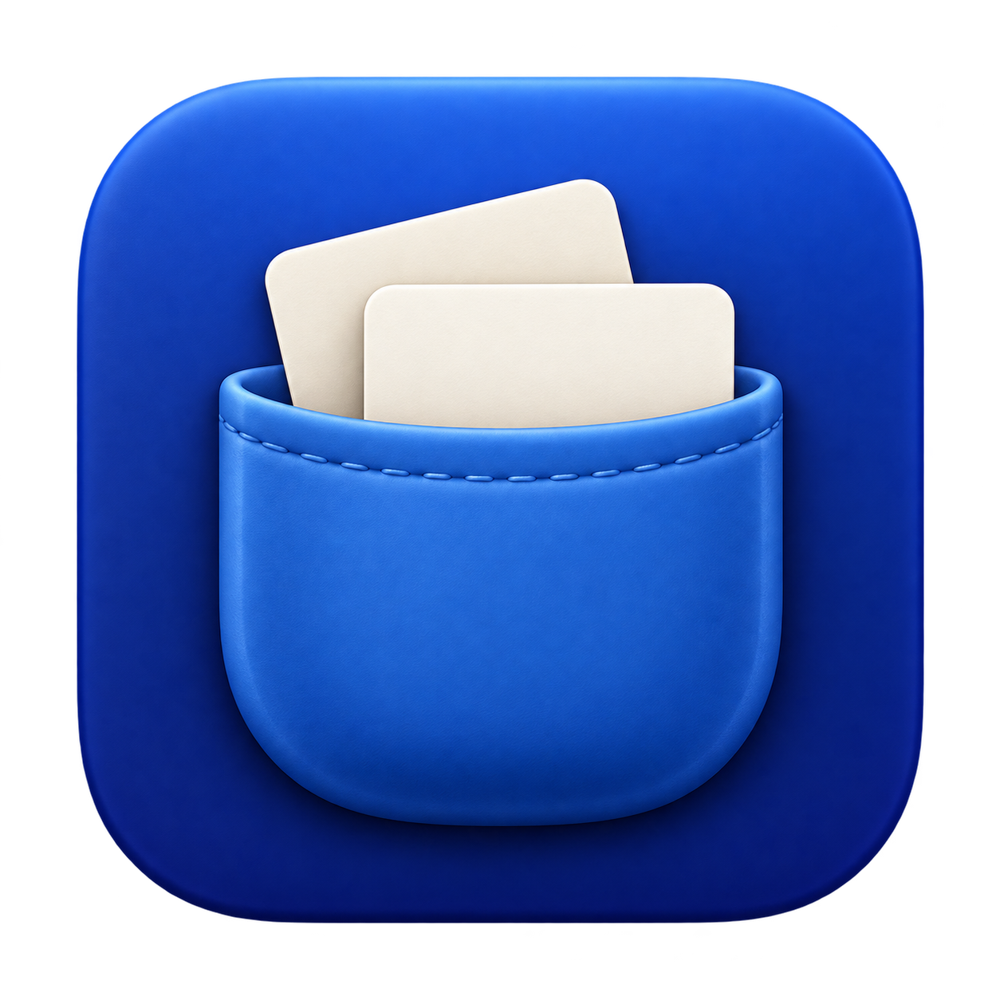

# Bolso

<p align="center"></p>

Histórico da área de transferência e captura de tela para macOS. Fica na barra de menus, guarda os últimos 25 itens copiados e tem um editor para marcar imagens e prints.

## Baixar

1. Baixe o `.zip` da [versão mais recente](https://github.com/IagoCappeletti/Bolso/releases/latest) e abra o arquivo.
2. Arraste o **Bolso** para a pasta **Aplicativos** e abra.
3. Na primeira vez o macOS bloqueia, porque o app não vem da App Store. Clique em **Concluído**, vá em **Ajustes do Sistema → Privacidade e Segurança**, role até o aviso do Bolso e clique em **Abrir Mesmo Assim**.
4. Ligue o Bolso em **Acessibilidade**, para ele colar sozinho, e em **Gravação da Tela**, que o macOS pede no primeiro ⌘⇧2.

Funciona no macOS 13 ou mais novo, em Macs com chip Apple ou Intel. Para abrir junto com o Mac, marque **Abrir ao iniciar o Mac** no menu do ícone.

As versões seguintes chegam sozinhas: o Bolso baixa em segundo plano e pergunta se pode reiniciar, porque reiniciar limpa o histórico. Com **Depois**, ele atualiza na próxima vez que fechar.

## Atalhos

| Tecla | Ação |
| --- | --- |
| ⌘⇧V | Abrir o histórico |
| ⌘⇧2 | Capturar uma área da tela |
| ↑ ↓ e Enter | Escolher e colar |
| ⌘1–⌘9 | Colar o item daquela posição |
| ⌥ + Enter, ⌘número ou clique | Colar como texto puro |
| ⌘E ou clique na foto | Editar a imagem |
| Arrastar a miniatura | Levar para outro app |
| Esc | Fechar |

## Histórico

- Guarda textos (com formatação), imagens e arquivos copiados; itens repetidos sobem para o topo.
- Fica só na memória: o histórico zera quando o app fecha.
- Ignora o que gerenciadores de senha marcam como sigiloso.
- Ao escolher um item, volta para o app anterior e cola sozinho.

## Captura e editor

**⌘⇧2** congela a tela: clique numa janela ou arraste uma área. Até a primeira marcação dá para ajustar pelas alças ou mover pela alça do topo. O editor de imagens do histórico tem as mesmas ferramentas: desenhar, marcador, seta, caixa, círculo, texto (com fundo opcional), números (1, 2, 3…) e desfocar.

- **Copiar** (⌘C) põe a imagem na área de transferência e no histórico.
- **Copiar texto** (⌘⇧C) lê o texto com o OCR do macOS; áreas desfocadas continuam ilegíveis.
- **Salvar** (⌘S) grava um PNG, e a alça ✋ arrasta a imagem para outro app.
- ⌘Z e ⌘⇧Z desfazem e refazem. Esc cancela; se houver marcações, a barra pergunta antes.

## Limites

- Imagens acima de 32 MiB ou 24 milhões de pixels ficam só em miniatura, sem edição. O histórico guarda até 128 MiB de imagens.
- Cópias feitas a menos de 0,5 s uma da outra podem se perder.
- Na primeira abertura de cada versão, o OCR leva cerca de um minuto para ficar pronto.
- Arrastar uma imagem cria um PNG temporário, apagado em 2 minutos. Fora isso, nada vai para o disco sem você salvar.

## Compilar

Feito em Swift, sem Xcode. A única dependência é o [Sparkle](https://sparkle-project.org), que faz as atualizações. Precisa das Command Line Tools (`xcode-select --install`).

```sh
./build.sh --install   # compila, fecha o Bolso aberto, instala em /Applications e abre
./build.sh --release   # gera dist/Bolso-<versão>.zip universal (chip Apple e Intel) e dist/appcast.xml
./build.sh             # só gera dist/Bolso.app
```

Para lançar uma versão, mude `VERSION` no `build.sh`, rode `./build.sh --release` e publique uma Release `v<versão>` com o `.zip` e o `appcast.xml`. Os apps instalados procuram o `appcast.xml` da Release mais recente.

<details>
<summary>Assinatura</summary>

O `build.sh` assina o app com um certificado autoassinado do Acesso às Chaves. Mantendo o mesmo certificado, quem atualiza não precisa dar as permissões de novo. Em outro Mac, crie um em **Acesso às Chaves → Assistente de Certificado → Criar um Certificado…** (Raiz Autoassinada, Assinatura de Código, depois **Confiar Sempre**) e rode `SIGN_IDENTITY="nome do certificado" ./build.sh`. Sem certificado, use `SIGN_IDENTITY=- ./build.sh`; aí o macOS pede as permissões a cada build.

As atualizações são assinadas com outra chave, do Sparkle, também guardada no Acesso às Chaves deste Mac. Sem ela, os apps instalados não aceitam versões novas. Para fazer uma cópia de segurança, rode `.build/artifacts/sparkle/Sparkle/bin/generate_keys -x arquivo` e guarde o arquivo num lugar seguro.

</details>

As Command Line Tools não trazem XCTest, então os testes são executáveis e usam áreas de transferência temporárias:

```sh
swift run -c release BolsoChecks                # modelo, imagens, geometria e OCR
swift run -c release Bolso --self-test          # histórico e memória
swift run -c release Bolso --ui-self-test       # painel
swift run -c release Bolso --editor-self-test   # editor
swift run -c release Bolso --capture-self-test  # captura
swift run -c release Bolso --render-screens <pasta>  # imagens de todas as telas, com conteúdo de exemplo, para revisar o visual
```
